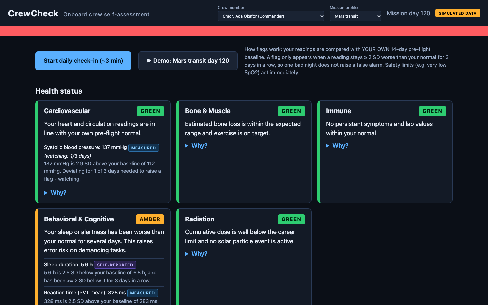
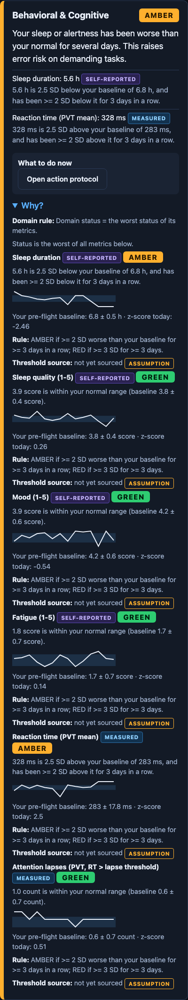
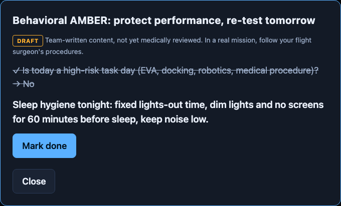
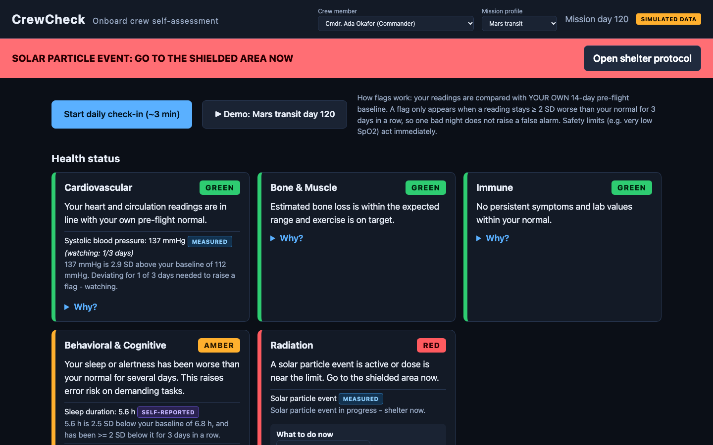
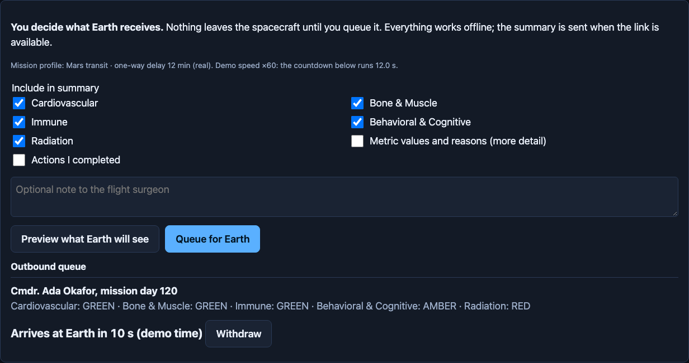
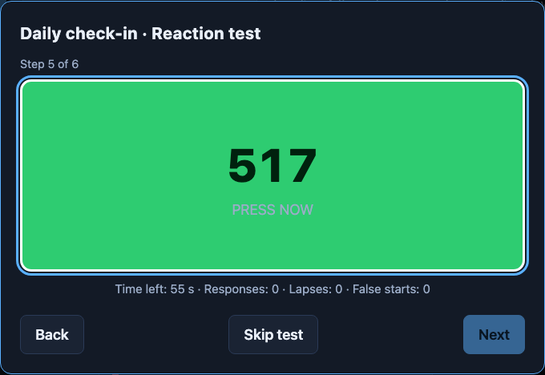
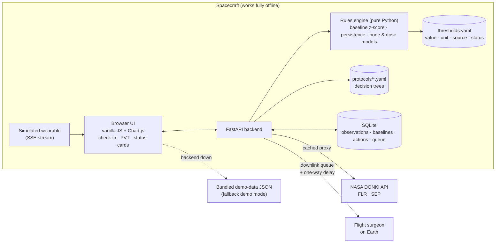

# CrewCheck: onboard crew self-assessment

**NASA Space Apps Challenge 2026.** A daily ~3-minute check-in that lets astronauts on long missions **evaluate** their health against their *own* pre-flight baseline and **act** on it, fully offline, with a summary sent to Earth through a realistic communication delay.

> ⚠️ All health data in this project is **SIMULATED**, all thresholds are currently marked **ASSUMPTION** (see [SOURCES.md](SOURCES.md)), and CrewCheck is a decision-support prototype, **not a medical device**.



## The problem
Long-duration crews face radiation, isolation, altered gravity and a closed environment, which can bring immune changes, bone loss, cardiovascular events and behavioral health problems. Far from Earth, with minutes of signal delay, **astronauts must spot these changes in themselves**. A wall of raw numbers doesn't help. Each number has to answer *"what does this mean for me?"* and *"what should I do now?"*

## The solution
1. **Daily check-in** (sleep, mood, fatigue, symptoms, exercise) plus a **reaction-time test** in Psychomotor Vigilance Test style, timed in the browser with `performance.now()`.
2. **Personal baseline engine.** Each value is compared with the astronaut's own 14-day pre-flight baseline (z-score). A flag fires only if the deviation **persists 3 days in a row**, which cuts false alarms. Safety limits (e.g. very low SpO2) act immediately.
3. **Five status cards**, one per challenge domain: Cardiovascular · Bone & Muscle · Immune · Behavioral & Cognitive · Radiation. Each shows GREEN / AMBER / RED, a plain-English meaning, the triggering data, and an expandable **"Why?"** with the rule, the formula and the threshold status.
4. **Action protocols.** Decision trees stored as YAML content files, not code. Every completed step is logged.
5. **Radiation module.** Cumulative dose vs. career limit, a live solar-activity feed from **NASA DONKI** (cached, with an offline sample), and a solar particle event triggers "go to the shielded area".
6. **Downlink queue.** The astronaut chooses exactly what Earth receives, previews it, and can withdraw it. The countdown uses the real one-way delay of the mission profile (ISS / Moon / Mars).
7. **Provenance badge on every metric:** MEASURED · SELF-REPORTED · LAB-ENTERED · MODEL-ESTIMATED.

## 30-second demo
Click **▶ Demo: Mars transit day 120**, then **Next** (or **Auto-play**):

| Step | What happens |
|---|---|
| 1 | Three nights of poor sleep + slower reaction time, each ≥ 2 SD worse than the commander's **own** baseline for 3 days → **Behavioral AMBER** |
| 2 | The AMBER protocol opens: protect critical tasks, sleep hygiene, re-test tomorrow |
| 3 | A solar particle event → **Radiation RED** → shelter protocol + full-width alert |
| 4 | Summary queued for Earth → 12-minute one-way delay countdown (accelerated ×60 for the demo) |

| "Why?" explanation | Action protocol | Solar event |
|---|---|---|
|  |  |  |

| Downlink with privacy controls | Reaction-time test |
|---|---|
|  |  |

## Architecture


**Honesty by design:** every number used by the engine lives in [`backend/config/thresholds.yaml`](backend/config/thresholds.yaml) with `value, unit, source_title, source_url, status, todo`. The server refuses to start if any entry is incomplete, or if one is marked `VERIFIED` without a source. [SOURCES.md](SOURCES.md) is generated from that file.

## How to run (macOS / Linux)
Requires Python 3.14.
```bash
git clone https://github.com/romar1oz/crew-health-monitor.git
cd crew-health-monitor
python3.14 -m venv .venv
source .venv/bin/activate
pip install -r requirements.txt
cd backend
uvicorn app.main:app --reload
```
Open **http://localhost:8000**.

- **Tests:** `cd backend && pytest -q` (85 tests; the rules engine is the most heavily tested part).
- **NASA API key (optional):** copy `.env.example` to `.env` and set `NASA_API_KEY` (free at https://api.nasa.gov). Without it, `DEMO_KEY` is used (rate-limited); the app then falls back to the cache or the bundled sample, and the UI says which one is shown.
- **Fallback demo mode:** if the backend is unreachable, the frontend loads `frontend/demo-data/` and still plays the full demo. Regenerate it with `python scripts/export_demo_data.py`.
- **Regenerate SOURCES.md** after editing thresholds: `python scripts/gen_sources.py`.

## NASA data used
- **DONKI** (Space Weather Database Of Notifications, Knowledge, Information) via https://api.nasa.gov: solar flares (`FLR`) and solar energetic particle events (`SEP`) for the last 30 days. Proxied by the backend with a 30-minute cache and an offline sample, which is clearly labelled as not real.
- Candidate physiological and radiation references are listed as **leads to verify** in [SOURCES.md](SOURCES.md).

## Project structure
```
backend/   FastAPI app, rules engine, config/thresholds.yaml, content/protocols, scenarios, tests
frontend/  index.html, css/, js/ (ES modules), vendor/chart.umd.min.js, demo-data/
docs/      screenshots
```

## Team, AI usage and license
- AI usage disclosure: [AI_USAGE.md](AI_USAGE.md)
- Build plan and phase checklist: [PLAN.md](PLAN.md)
- License: [MIT](LICENSE)
